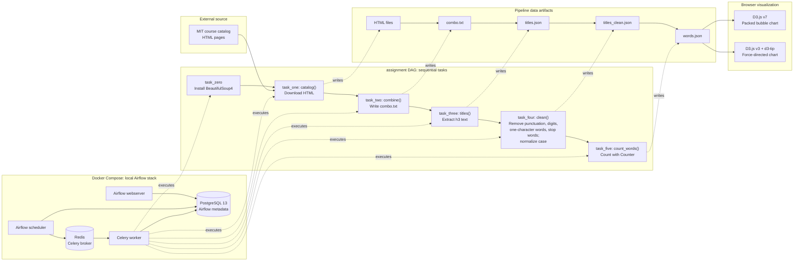

# Architecture

## System context

The project has two main paths: an Airflow-managed ETL pipeline and a browser-based visualization that consumes the pipeline's final JSON output.

## Component responsibilities

| Layer | Component | Responsibility |
|---|---|---|
| Source | MIT course catalog | Serves HTML pages containing course titles |
| Orchestration | Airflow DAG `assignment` | Declares the task order and daily schedule |
| Task execution | Celery worker | Runs the Python and Bash task callables |
| Broker | Redis | Delivers Celery work to the worker |
| Metadata | PostgreSQL | Stores Airflow DAG/task/run metadata |
| Ingestion | `urllib.request` | Retrieves catalog page responses |
| Parsing | BeautifulSoup4 | Finds `<h3>` elements and extracts their text |
| Transformation | Python string operations | Removes selected punctuation, digits, one-character tokens, and common English stop words; lowercases remaining tokens |
| Aggregation | `collections.Counter` | Produces a word-to-count mapping |
| Visualization | D3.js | Renders word frequency as packed bubbles or force-directed circles |

## Task contracts

| Order | Task callable | Input | Output |
|---|---|---|---|
| 0 | Bash package setup | — | BeautifulSoup4 installed in the worker environment |
| 1 | `catalog()` | Configured catalog URLs | One HTML file per successful URL |
| 2 | `combine()` | `*.html` files in the worker working directory | `combo.txt` |
| 3 | `titles()` | `combo.txt` | `titles.json`, an array of extracted title strings |
| 4 | `clean()` | `titles.json` | `titles_clean.json`, an array of normalized titles with stop words removed |
| 5 | `count_words()` | `titles_clean.json` | `words.json`, a JSON object mapping words to integer counts |

The DAG is linear: each task starts only after its upstream task succeeds. The configured daily schedule is paused at creation by the local Compose environment, so an operator must unpause or manually trigger it in Airflow.

## Storage and deployment boundary

The Compose file bind-mounts `dags`, `logs`, and `plugins`; it does not define a persistent shared volume for the generated catalog and JSON artifacts. As implemented, intermediate files are written relative to the Airflow task's working directory. The checked-in `code_visualization/words.json` is a portable output snapshot; pipeline output must be copied there to update the chart.

For durable or distributed execution, define explicit artifact paths on a shared volume or object store. Do not rely on a worker container's local working directory as a persistent data layer.

## Runtime and dependency caveats

- The Compose configuration uses Apache Airflow `2.1.1`, PostgreSQL `13`, and a mutable `redis:latest` image. The Airflow runtime observed for this project uses Python 3.6.
- The task installs BeautifulSoup4 using `pip` at runtime. A production deployment should build and pin dependencies in a custom Airflow image.
- The legacy force-directed page loads D3 v3 and d3-tip; the packed bubble page uses D3 v7. They are separate examples with different APIs.
- The Docker Compose file is intended for local development and contains default credentials; do not expose this setup to an untrusted network.
