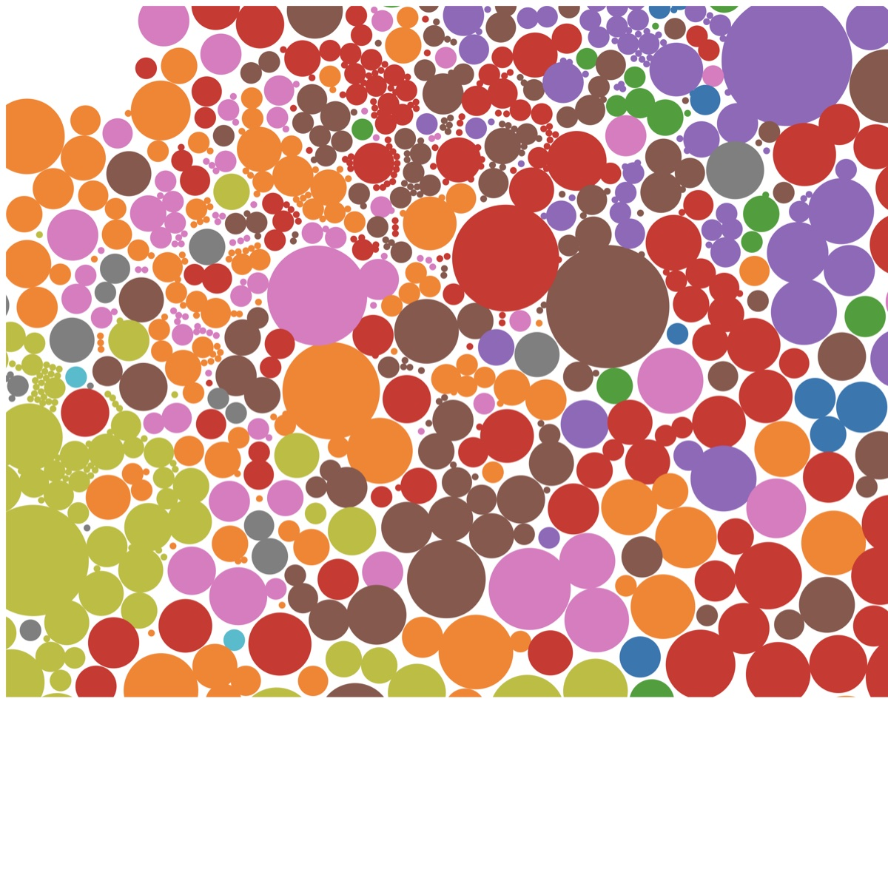
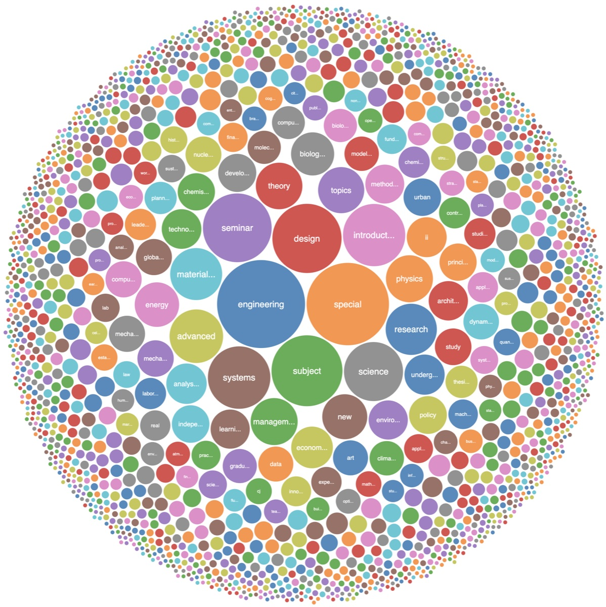

# MIT Course Catalog Analytics Pipeline

An Airflow-orchestrated Python pipeline that collects public MIT course catalog pages, extracts and cleans course titles, calculates word frequencies, and presents the results in interactive D3.js bubble charts.

> **Portfolio context:** This is an educational data-engineering project, not an MIT product or an official MIT data service. Catalog content is retrieved from the public [MIT course catalog](http://student.mit.edu/catalog/).

## Project at a glance

| | |
|---|---|
| **Repository name** | `mit-course-catalog-analytics-pipeline` |
| **GitHub description** | `Airflow-orchestrated ETL pipeline for MIT course catalog titles, word-frequency analytics, and D3.js visualization.` |
| **Pipeline pattern** | Scheduled, sequential ETL DAG |
| **Input** | Public HTML course catalog pages |
| **Primary output** | Word-to-frequency JSON mapping |
| **Visualization** | D3.js packed bubble charts |

## What it does

The Airflow DAG coordinates six sequential tasks:

| Task | Airflow task ID | Responsibility | Output |
|---|---|---|---|
| Dependency setup | `task_zero` | Installs BeautifulSoup4 in the Airflow worker | — |
| Catalog ingestion | `task_one` | Fetches 46 available catalog pages with Python `urllib.request` | Individual HTML pages |
| Consolidation | `task_two` | Combines local HTML pages | `combo.txt` |
| Title extraction | `task_three` | Parses `<h3>` elements with BeautifulSoup | `titles.json` |
| Data cleaning | `task_four` | Removes configured punctuation, digits, one-character words, and common English stop words; lowercases remaining words | `titles_clean.json` |
| Word analysis | `task_five` | Counts title words with `collections.Counter` | `words.json` |

The catalog request list omits `m10c.html`, which currently returns HTTP 404. The ingestion task waits 15 seconds between requests; a complete run therefore takes several minutes.

## Engineering concepts demonstrated

- Orchestrating dependent ETL tasks with an Airflow DAG
- Retrieving and parsing unstructured HTML from a public source
- Cleaning text and transforming it into structured JSON
- Aggregating word frequencies and visualizing the result
- Running local orchestration services with Docker Compose

## Architecture

See [ARCHITECTURE.md](./ARCHITECTURE.md) for the component diagram, data contracts, and operational notes.

```mermaid
flowchart LR
    A[MIT course catalog HTML] --> B[urllib ingestion]
    B --> C[Raw HTML pages]
    C --> D[Combine into combo.txt]
    D --> E[BeautifulSoup title extraction]
    E --> F[titles.json]
    F --> G[Clean titles]
    G --> H[titles_clean.json]
    H --> I[Counter word frequencies]
    I --> J[words.json]
    J --> K[D3.js bubble chart]
```



## Technology

| Component | Use in this project |
|---|---|
| Apache Airflow | Defines and schedules the `assignment` DAG; uses `PythonOperator` and `BashOperator` |
| Docker Compose | Runs the local Airflow webserver, scheduler, worker, PostgreSQL, and Redis services |
| PostgreSQL 13 | Airflow metadata database |
| Redis | Celery task broker (`redis:latest` in the current Compose configuration) |
| Python | HTTP retrieval, file handling, HTML parsing, text cleanup, and frequency aggregation |
| BeautifulSoup4 | Extracts course-title text from HTML `<h3>` elements |
| D3.js v3 + d3-tip | Original force-directed bubble visualization |
| D3.js v7 | Responsive packed bubble chart using the generated JSON |

The checked-in Compose file uses Apache Airflow `2.1.1`; the observed container runtime uses Python 3.6. These are retained from the course environment, not presented as current production recommendations. See [production considerations](#production-considerations).

## Repository layout

```text
.
├── assignment.py
├── airflow-docker/
│   ├── dags/
│   │   └── assignment.py
│   └── docker-compose.yaml
├── assets/
│   ├── mit-course-force-graph.jpg
│   └── mit-course-packed-bubble-chart.jpg
├── project_creating_a_sensemaking_data_pipeline/
│   ├── 00_urls.txt
│   ├── 01_pull.py
│   └── code_visualization/
│       ├── d3.tip.js
│       ├── mitcourses_graph.html
│       ├── mitcourses_graph.js
│       ├── styles-example.css
│       ├── word_frequency_bubble_chart.html
│       ├── words.js
│       └── words.json
├── ARCHITECTURE.md
└── README.md
```

`airflow-docker/dags/assignment.py` is the DAG file mounted into Airflow. Keep it synchronized with the top-level `assignment.py` when editing the pipeline.

## Run the pipeline locally

### Prerequisites

- Docker Desktop with Docker Compose v2
- An internet connection for catalog retrieval and the D3.js CDN
- A terminal and browser

### Start Airflow

From the repository root:

```bash
cd airflow-docker
export AIRFLOW_UID=50000
docker compose up airflow-init
docker compose up -d
docker compose ps
```

Open [http://localhost:8080](http://localhost:8080) and sign in with the local-development defaults `airflow` / `airflow`. The Compose configuration creates DAGs in a paused state: unpause the `assignment` DAG, then trigger a run from the Airflow UI.

To follow service logs:

```bash
docker compose logs -f airflow-scheduler airflow-worker
```

Stop the services from `airflow-docker/` with:

```bash
docker compose down
```

This leaves the named PostgreSQL volume intact. Avoid `docker compose down -v` unless you intend to delete the local Airflow metadata database.

### View the D3.js visualization

The D3 v7 page loads `words.json` with `fetch`; browsers block this local file request when the page is opened directly with a `file://` URL. Start a static server from the repository root in a separate terminal:

```bash
python3 -m http.server 8765
```

Open:

```text
http://localhost:8765/project_creating_a_sensemaking_data_pipeline/code_visualization/word_frequency_bubble_chart.html
```

Bubble area represents word frequency. Hover over a bubble for its full word and count. The original force-directed visualization is available at `code_visualization/mitcourses_graph.html`.

## Data and reproducibility notes

- The checked-in `words.json` is a sample output snapshot used by the visualizations. Re-run the DAG to regenerate the analysis from the live catalog.
- Changes to `clean()` apply only to new task runs; they do not update artifacts from earlier DAG runs.
- The worker writes intermediate files to `/opt/airflow`. The current Compose file mounts the DAG, logs, and plugins directories, but does **not** mount a durable data/output directory. After a successful run, from `airflow-docker/`, copy the final JSON into the visualization folder:

  ```bash
  docker compose cp airflow-worker:/opt/airflow/words.json ../project_creating_a_sensemaking_data_pipeline/code_visualization/words.json
  ```

- The original D3 v3 page uses `words.js`, which declares the global `scores` object; the D3 v7 chart reads `words.json` directly. Regenerate the JavaScript companion after copying the JSON:

  ```bash
  python3 -c 'import json, pathlib; p=pathlib.Path("../project_creating_a_sensemaking_data_pipeline/code_visualization/words.json"); data=json.loads(p.read_text(encoding="utf-8")); p.with_name("words.js").write_text("var scores = " + json.dumps(data, ensure_ascii=False, indent=4) + ";\n", encoding="utf-8")'
  ```

- Cleaning removes configured punctuation, digits, one-character tokens, and 124 curated English stop words, including `and`, `in`, `of`, `the`, `to`, `for`, and `it`. Matching is case-insensitive, and remaining words are lowercased so capitalization variants are counted together.

## Visual results

The force-directed chart uses D3 v3 and d3-tip. The packed chart uses D3 v7 and reads the word-frequency JSON directly.

| Force-directed word graph | Packed word-frequency chart |
|---|---|
|  |  |

## Production considerations

This repository demonstrates core ETL and orchestration concepts; its local Docker Compose setup is not production-ready. Before using a similar design for production:

- Upgrade to a currently supported Airflow and Python release and pin compatible image versions.
- Install BeautifulSoup4 in a custom, version-pinned Airflow image instead of installing packages from a DAG task at runtime.
- Persist data artifacts to a shared mounted volume or object storage, and make input/output paths explicit.
- Replace default local credentials, restrict exposed ports, and manage secrets outside source control.
- Add request timeouts, retries/backoff for transient HTTP errors, structured logging, and tests for parsing and cleaning.
- Normalize text consistently and define how missing, changed, or unavailable catalog pages should be handled.

## Data source

Course catalog pages are fetched from `student.mit.edu/catalog/`. The public website may change, remove pages, or return errors; the pipeline's source URL list and generated counts should be treated as time-specific.
